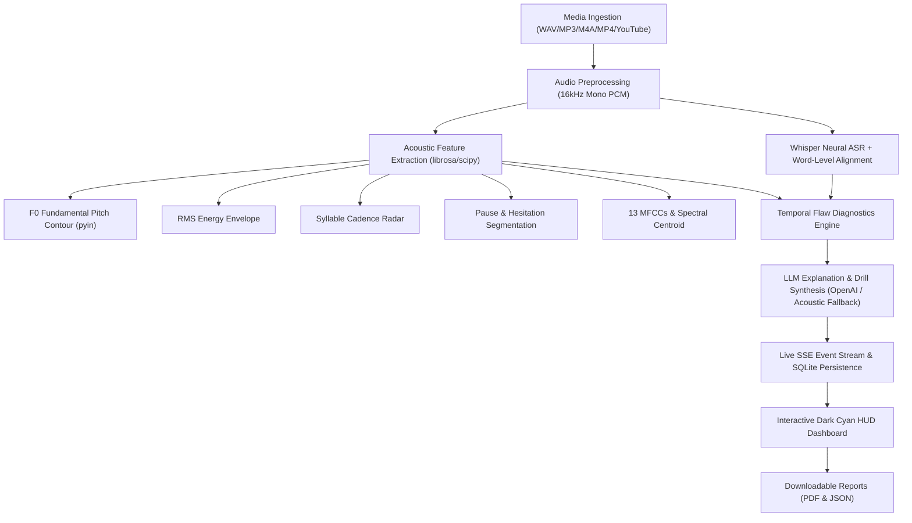

# JARVIS — AI-Powered Speech Intelligence & Temporal Flaw Detection

JARVIS is a high-precision, production-grade web application that analyzes public speaking from uploaded audio/video files and supported YouTube URLs. It detects delivery flaws, pinpoints their exact millisecond timestamps, explains them using verifiable acoustic evidence, and delivers actionable improvement drills.

---

## 1. Architectural Pipeline



---

## 2. Supported Speech Flaws & Acoustic Criteria

JARVIS never infers acoustic properties from text alone. Detections are computed strictly from physical audio measurements:

| Flaw Category | Acoustic Metric | Critical Threshold | Evidence Unit | Corrective Action |
|---|---|---|---|---|
| **Speaking Too Fast** | Syllable rate (energy peaks) | > 5.0 syl/sec | Syllables / sec | Insert deliberate 0.5s pause between clauses |
| **Speaking Too Slow** | Syllable rate | < 2.0 syl/sec | Syllables / sec | Energize vocal cadence and connect thought units |
| **Extended Silence** | Continuous energy < threshold | > 2.0 seconds | Seconds | Limit rhetorical pauses to 1.0–1.8 seconds |
| **Awkward Pause** | Mid-sentence hesitation | 0.5s – 2.0s without punctuation | Seconds | Breathe at syntactic boundaries only |
| **Monotone Delivery** | Fundamental pitch std dev | < 10.0 Hz over 3+ sec | Hertz (Hz) | Elevate pitch on focal nouns and verbs |
| **Pitch Crack / Spike** | Frame-to-frame F0 jump | > 100 Hz | Hertz (Hz) | Diaphragmatic breath support to stabilize register |
| **Mumbling / Low Energy** | RMS relative to mean | < 20% of mean RMS (> 1s) | Ratio | Project voice from chest cavity |
| **Verbal Fillers** | ASR token matching | "um", "uh", "like", "you know" | Token count | Replace vocal crutches with silent breath |
| **Vocal Fry** | Low F0 + high aperiodicity | 45 – 80 Hz | Hertz (Hz) | Lift vocal pitch at sentence completions |
| **Inconsistent Volume** | RMS coefficient of variation | CV > 0.65 within sentence | Ratio | Stabilize microphone distance and breath stream |

---

## 3. Tech Stack

- **Backend**: Python 3.11, FastAPI, Uvicorn, SQLite-Utils, SSE-Starlette, Pydantic v2
- **Audio & ML**: Librosa, SoundFile, Pydub, PyTorch, OpenAI Whisper (`base` model with word timestamps), ImageIO-FFmpeg (bundled standalone FFmpeg 7.1 binary)
- **Reporting**: FPDF2 (Executive PDF diagnostic reports), JSON export
- **Frontend**: Next.js 14 (App Router), React 18, TypeScript, Tailwind CSS, WaveSurfer.js v7, Recharts, Lucide Icons

---

## 4. Quick Start Guide

### Step 1: Launch Backend
```bash
cd backend
python run.py
```
*The FastAPI backend will start on `http://localhost:8000` with automatic database migration, benchmark dataset seeding, and Swagger UI at `http://localhost:8000/docs`.*

### Step 2: Launch Frontend
```bash
cd frontend
npm run dev
```
*Open `http://localhost:3000` in your browser to access the JARVIS Speech HUD.*

---

## 5. API Reference

| Method | Endpoint | Description |
|---|---|---|
| `POST` | `/api/upload` | Multipart upload for WAV, MP3, M4A, MP4 (starts background pipeline) |
| `POST` | `/api/analyze-url` | Ingest and analyze YouTube or media URL via `yt-dlp` |
| `GET` | `/api/analysis/{id}` | Retrieve full analysis results, metrics, and findings |
| `GET` | `/api/analysis/{id}/status` | Server-Sent Events (SSE) live progress stream |
| `GET` | `/api/analysis/{id}/audio` | Stream normalized 16kHz WAV audio |
| `GET` | `/api/analysis/{id}/waveform` | 2,000-point downsampled waveform for UI rendering |
| `GET` | `/api/analysis/{id}/export/json` | Download complete JSON telemetry report |
| `GET` | `/api/analysis/{id}/export/pdf` | Download formatted executive PDF report |
| `GET` | `/api/analysis/{id}/compare` | Benchmark delivery comparison against ideal reference |
| `PUT` | `/api/analysis/{id}/transcript` | Submit manual transcript corrections |
| `POST` | `/api/analysis/{id}/reanalyze` | Re-run diagnostics on updated transcript |
| `GET` | `/api/analyses` | List session history |
| `DELETE` | `/api/analysis/{id}` | Delete analysis and purge audio artifacts |
| `GET` | `/api/dataset` | Query contrastive paired speech dataset |
| `POST` | `/api/evaluation/benchmark` | Compute IoU, Precision, Recall, and F1 against ground truth |

---

## 6. Contrastive Dataset & Reproducible Evaluation

JARVIS includes a pre-seeded contrastive dataset in SQLite (`dataset_entries` table) featuring:
- Studio reference recordings (`reference_good`)
- Paced variations (`flawed_rate`, `flawed_prosody`, `flawed_fluency`)
- Ground-truth temporal intervals with documented provenance

Run evaluations against annotated ground-truth using `/api/evaluation/benchmark`. Precision, Recall, and F1 are calculated using 1D temporal interval Intersection over Union (IoU $\ge 0.3$).

---

## 7. Reliability, Ethics & Security

1. **Accent Neutrality**: Natural dialect and regional phonetic patterns are never classified as delivery flaws.
2. **Measurable Telemetry**: Deviations reference measured Hz, seconds, or RMS ratios without psychoanalytic claims.
3. **Privacy**: Audio files remain locally stored; deletions permanently remove files and SQLite records.
4. **Key Isolation**: LLM keys remain server-side only in `.env`. A rule-based fallback guarantees full functionality without API keys.


## Upload scoring v3 (evidence-normalized)

The upload-based scoring engine is in `backend/app/scoring.py`.

- Pace uses measured syllables/second and local rate windows; detector findings for the same pace issue are not counted a second time.
- Fluency uses filler density per 100 transcript words and measured pauses longer than two seconds.
- Vocal delivery uses relative pitch variation when frame-level pitch is available and estimates energy variability from active-energy frames to reduce silence double-counting.
- Visual presentation requires measured frame/lighting/motion/framing metrics; missing metrics are not replaced by default scores.
- Grammar is shown as unavailable until a genuine language-quality evaluator is connected. Acoustic pauses and volume changes are not presented as grammar errors.
- The composite normalizes weights across available components and includes a scoring version so legacy cached results are recalculated when opened.
- Thresholds are provisional coaching heuristics, not validated universal standards. See `backend/test_scoring_v3.py` for scoring regression tests.

Run backend scoring regression tests from the `backend` directory with:

```bash
python -m unittest test_scoring_v3.py
python test_audit_upload.py
```
